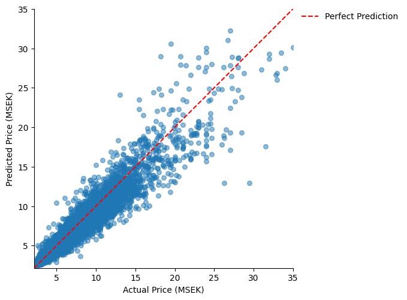

# Real Estate Price Prediction

A project comparing three supervised regression models for predicting
real estate prices in Stockholm's inner city, using real transaction
data from the Booli API (2012-2024).

**Authors:** Alexander Maleki & Andrea Woldemar

## Approach

- Data: historical apartment sales retrieved from the Booli API, restricted
  to Stockholm's inner city (Södermalm, Östermalm, Vasastaden, Kungsholmen)
- Time-aware split: trained on 2012-2023, tested on 2024, to simulate
  real-world forecasting rather than random shuffling
- Models: Random Forest, XGBoost, and k-NN, each tuned via `OptunaSearchCV`
  with 5-fold time-series cross-validation

## Code

- `src/preprocess.py` - cleans the raw data, splits it by time, encodes and
  scales features
- `src/train_models.py` - trains baseline models, then tunes each with Optuna
- `src/generate_plots.py` - regenerates the result figures from the trained models

## Results

Performance on the 2024 test set, after hyperparameter tuning:

| Model         | MAE (SEK) | RMSE (SEK) | R²   |
|---------------|-----------|------------|------|
| **XGBoost**   | 738,989   | 1,217,465  | 0.90 |
| Random Forest | 743,366   | 1,235,145  | 0.90 |
| k-NN          | 844,807   | 1,355,730  | 0.88 |

XGBoost gave the best overall fit and improved the most from tuning.

## Notes

The raw dataset isn't included here, since it originates from the Booli API
and isn't ours to redistribute - `src/preprocess.py` documents the full retrieval
and cleaning pipeline instead.
